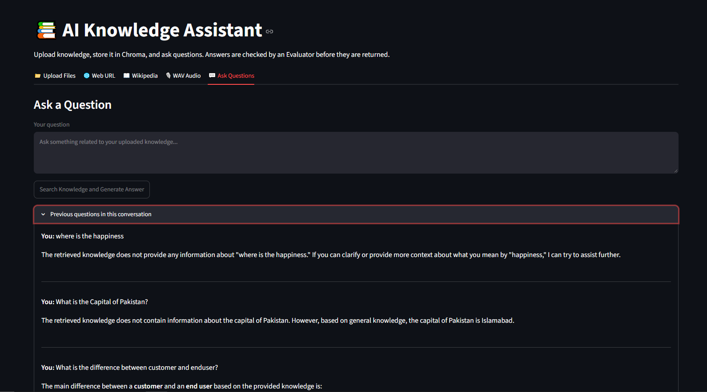
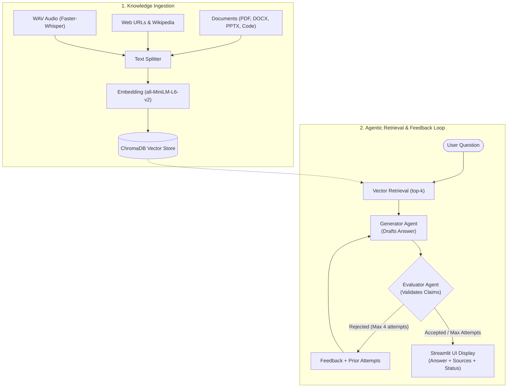

# 🤖 AI Knowledge Assistant

An intelligent, multi-source **Retrieval-Augmented Generation (RAG)** assistant with an **autonomous Generator-Evaluator feedback loop**. The application ingests documents, web pages, Wikipedia articles, and audio files, stores semantic embeddings in ChromaDB, and verifies every generated answer against ground-truth context before presenting it to the user.

---

## 📸 Application

The project uses **RAG (Retrieval-Augmented Generation)** to improve answers by providing the model with relevant information from the knowledge base.

### 💬 1. Interactive Q&A Interface & Verified Answers
_Ask questions based on your ingested knowledge base. The assistant displays the verified response, confidence banners, and citations._




---

### 📥 2. Multi-Source Knowledge Ingestion
_Upload local documents (PDF, DOCX, PPTX, Code, TXT), scrape websites, fetch Wikipedia topics, or transcribe WAV audio recordings._


---

### 🔄 3. Generator & Evaluator Feedback Loop in Action
_Inspect the evaluation breakdown, validation status, and iterative attempt revisions when an answer requires refinement._

## 5. How to Run the Project

---

## ✨ Key Features

- **Multi-Format Document Ingestion:**
  - Local files: PDF (`pypdf`), Word (`docx2txt`), PowerPoint (`unstructured`), Markdown, Plain Text, CSV, JSON, and source code files (`.py`, `.js`, `.html`, `.css`).
  - Web scraping: Ingest full webpage contents via URL (`WebBaseLoader`).
  - Wikipedia search: Search and retrieve articles on any topic (`WikipediaLoader`).
  - Audio transcription: Transcribe spoken audio (`.wav`) locally using **Faster-Whisper** (`base` model on CPU with `int8` quantization).
- **Vector Search with ChromaDB:**
  - Chunks text with recursive character splitting (`chunk_size=1000`, `chunk_overlap=200`).
  - Computes dense embeddings locally using `sentence-transformers/all-MiniLM-L6-v2` via `langchain-huggingface`.
  - Persists vectors to `./chroma_db` with MD5 content deduplication.
- **Autonomous Generator-Evaluator Feedback Loop:**
  - **Generator Agent:** Synthesizes direct, grounded answers from retrieved context.
  - **Evaluator Agent:** Cross-checks generated answers against strict criteria using retrieved documents as the sole source of truth.
  - **Iterative Refinement:** If an answer contains unsupported claims, inaccuracies, or omissions, actionable feedback is fed back to the Generator for up to **4 attempts**.
- **Dual-Isolated Conversation Memory:**
  - **Generator Memory:** Tracks user queries, past attempts, and feedback received to enable conversational continuity.
  - **Evaluator Memory:** Privately tracks evaluation history and decisions without polluting the generator context.
  - Per-session memory management with a one-click reset in the UI.
- **Modern Streamlit Dashboard:**
  - Dedicated tabs for file uploads, URLs, Wikipedia, audio transcription, and chat.
  - Real-time status badges (`Accepted`, `Not Validated`, `No Knowledge Found`, `Error`).
  - Expandable panels for retrieved source documents, evaluator attempt history, and previous questions.

---

## 🏗️ System Architecture



---

## 📋 Evaluator Criteria

The Evaluator Agent verifies responses against 7 quality benchmarks:

| Criterion | Rule |
| :--- | :--- |
| **1. Accuracy** | Facts in the answer must precisely align with the retrieved documents. |
| **2. Relevance** | Directly addresses the specific question asked by the user. |
| **3. Completeness** | Covers all critical details and aspects supported by the context. |
| **4. Consistency** | Contains no internal contradictions or conflicting statements. |
| **5. Grounding** | Every claim can be directly traced to specific retrieved chunks. |
| **6. No Unsupported Claims** | Zero hallucinations; does not pull facts from pre-trained external knowledge. |
| **7. Clarity & Quality** | Concise, professional, and well-structured output. |

> **Honest Fallback:** If the retrieved context does not contain the answer, the assistant is instructed to state that the information is unavailable rather than speculating.

---

## 📁 Project Structure

```text
AI_Knowledge_Assistant/
├── agents/
│   ├── evaluator.py            # Evaluator agent logic, prompt, and JSON output parser
│   ├── feedback_loop.py        # Coordinates Generator-Evaluator iterative loop
│   └── generator.py            # Generator agent logic and context formatting
├── assets/
│   └── screenshots/            # Directory for application screenshots
├── chroma_db/                  # Persistent Chroma vector store directory
├── data/
│   └── uploads/                # Temporary storage for uploaded documents
├── knowledge_base/
│   ├── audio_loader.py         # WAV audio loader using Faster-Whisper
│   ├── document_loader.py      # Multi-format document loader (PDF, DOCX, PPTX, TXT, Code)
│   ├── ingestion.py            # Pipeline for splitting and storing chunks
│   ├── text_splitter.py        # RecursiveCharacterTextSplitter configuration
│   ├── url_loader.py           # Web page scraper using WebBaseLoader
│   ├── vector_store.py         # Chroma initialization, embedding setup, and similarity search
│   └── wikipedia_loader.py     # Wikipedia search and article ingestion
├── memory/
│   ├── evaluator_memory.py     # Isolated memory tracking Evaluator judgments
│   └── generator_memory.py     # Isolated memory tracking conversation and attempts
├── .env                        # Environment variables (API keys and model configs)
├── .gitignore                  # Git ignore rules
├── llm.py                      # Centralized LLM client initialization (ChatOpenAI)
├── main.py                     # Streamlit frontend user interface
├── README.md                   # Project documentation
└── requirements.txt            # Python dependencies
```

---

## 🚀 Getting Started

### Prerequisites

- **Python 3.10+** (Tested on Python 3.11 & 3.13)
- An active OpenAI or OpenAI-compatible API key (OpenAI, OpenRouter, LocalAI, vLLM, etc.)

---

### Step 1: Clone the Repository

```bash
git clone <repository_url>
cd Cellula_Final_Projects/AI_Knowledge_Assistant
```

---

### Step 2: Create and Activate a Virtual Environment

**Windows (PowerShell):**
```powershell
python -m venv .venv
.\.venv\Scripts\Activate.ps1
```

**macOS / Linux:**
```bash
python3 -m venv .venv
source .venv/bin/activate
```

---

### Step 3: Install Dependencies

```bash
pip install -r requirements.txt
```

> **Included Packages:** `streamlit`, `langchain-core`, `langchain-community`, `langchain-openai`, `langchain-chroma`, `langchain-huggingface`, `chromadb`, `sentence-transformers`, `faster-whisper`, `pypdf`, `docx2txt`, `unstructured[pptx]`, `beautifulsoup4`, `wikipedia`, `python-dotenv`, `redis`.

---

### Step 4: Configure Environment Variables

Create a `.env` file in the `AI_Knowledge_Assistant` directory:

```env
OPENAI_API_KEY=your_api_key_here
BASE_URL=https://api.openai.com/v1
MODEL=gpt-4.1-mini-2025-04-14
```

*For OpenRouter users:*
```env
OPENAI_API_KEY=your_openrouter_api_key
BASE_URL=https://openrouter.ai/api/v1
MODEL=openai/gpt-4o-mini
```

---

### Step 5: Run the Application

Launch the Streamlit web application:

```bash
streamlit run main.py
```

Streamlit will print the local server URL (typically `http://localhost:8501`). Open it in your web browser.

---

## 💡 How to Use the App

1. **Ingest Knowledge:**
   - Go to **Upload Files**, **Load URL**, **Wikipedia**, or **Upload Audio**.
   - Select or upload your source and click the corresponding **Ingest** button.
   - The status box will confirm how many chunks were parsed and stored in the vector store.
2. **Ask Questions:**
   - Switch to the **💬 Ask Questions** tab.
   - Type your question and click **Ask Question**.
3. **Review Evaluation & Sources:**
   - View the generated answer and status banner (`Accepted`, `Not Validated`, etc.).
   - Expand **Sources** to view the underlying documents used.
   - Expand **Evaluator feedback and attempts** to inspect the Evaluator's critique across any revision cycles.
4. **Manage Memory:**
   - Use the **🗑️ Clear conversation memory** button in the sidebar anytime to start a fresh topic session.

---

## 🛣️ Roadmap & Future Enhancements

- [x] **Core RAG Pipeline:** Document, URL, Wikipedia, and Audio ingestion.
- [x] **Agentic Feedback Loop:** Self-correcting Generator & Evaluator architecture.
- [x] **Dual Memory Isolation:** Distinct memory for Generator and Evaluator.
- [ ] **Redis Semantic Caching:** Cache frequently asked questions and vector embeddings for sub-second retrieval.
- [ ] **Hybrid Search:** Combine Chroma dense vector retrieval with BM25 sparse keyword retrieval.
- [ ] **Streaming Responses:** Stream intermediate generator tokens to the UI before evaluation.
